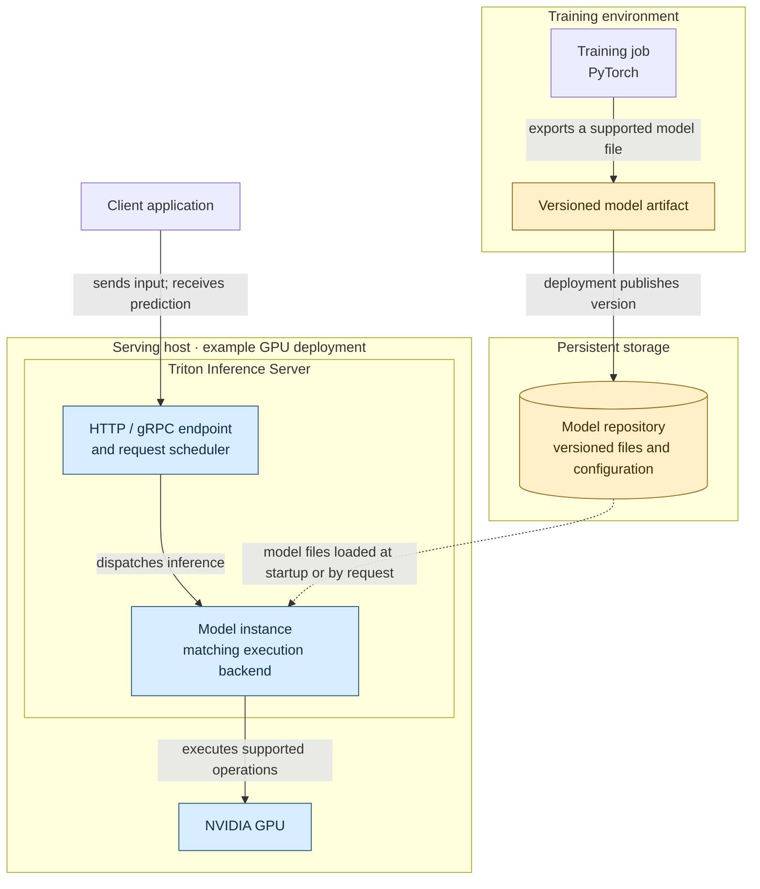
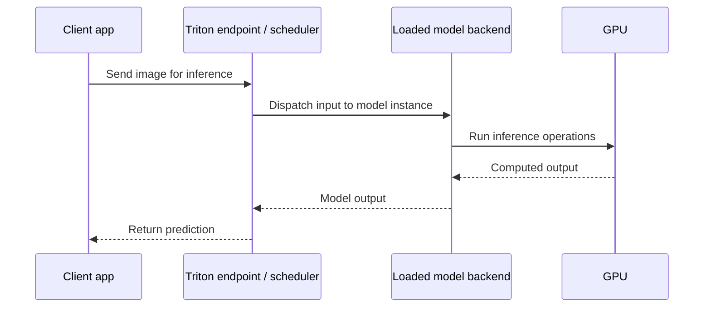

# Worked example: where does Triton sit?

Use these two drawings together. The architecture identifies who owns the files, which process runs the model, and what the application calls. The sequence follows one image through that architecture.

## Architecture: one GPU inference service

The dashed arrow is the **model load path**. The server can load a model once and serve many requests with that instance. The cylinder represents persistent storage. A TensorRT engine is one possible model artifact; the matching backend depends on the format you deploy.

## Runtime flow: one image, one prediction

**Recall check.** You have uploaded a new model version to the repository. What still needs to happen before it can answer requests? Triton must successfully load the version under its configured model control and version policies. A file in storage and a model ready to serve are two different states. [NVIDIA Triton architecture](https://docs.nvidia.com/deeplearning/triton-inference-server/user-guide/docs/index.html) · [Model management](https://docs.nvidia.com/deeplearning/triton-inference-server/user-guide/docs/user_guide/model_management.html)
